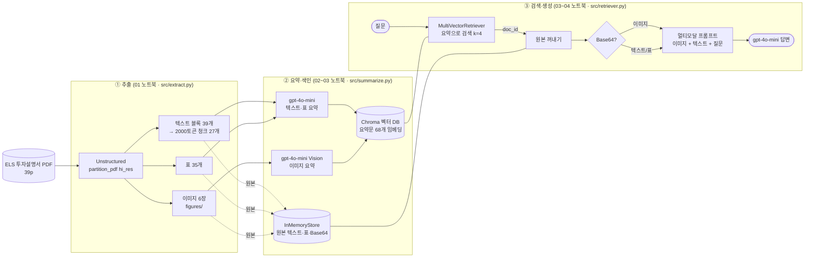
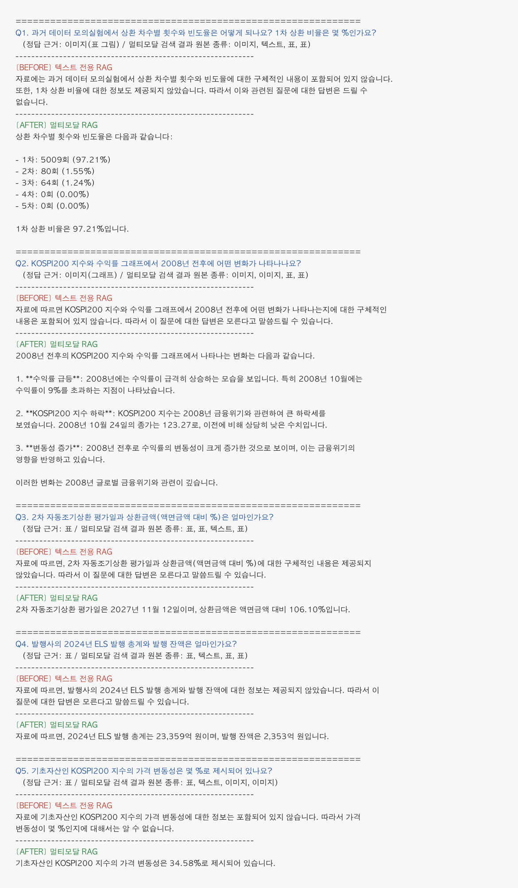

# Multimodal RAG — ELS 투자설명서 질의응답

PDF의 **텍스트·표·이미지**를 함께 검색해 답하는 멀티모달 RAG 파이프라인입니다.
대상 문서는 **교보증권 제12879회 주가연계파생결합사채(ELS) 투자설명서**(2026.11.04, 금감원 전자공시 DART 공개 자료)입니다.

---

## 1. 문제 정의

ELS 투자설명서에서 투자자가 실제로 궁금해하는 숫자는 대부분 **본문 문장이 아니라 표와 그래프**에 들어 있습니다.

| 투자자가 묻는 것 | 문서 안 위치 |
| --- | --- |
| "몇 차에 조기상환될 확률이 높은가?" | 과거 데이터 모의실험 결과 **표 (이미지로 삽입됨)** |
| "2008년 같은 하락장에서는 어땠나?" | KOSPI200 지수·수익률 **선 그래프** |
| "2차 조기상환일과 상환금액은?" | 자동조기상환 조건 **표** |
| "기초자산 변동성은?", "발행사 ELS 발행 규모는?" | 위험요소 / 발행사 현황 **표** |

텍스트만 임베딩하는 일반 RAG는 이 질문들에 "자료에 없다"고 답합니다 (아래 Before/After에서 5건 모두 실패).
특히 모의실험 결과는 표처럼 보이지만 실제로는 **그림 파일**이라 텍스트 추출로는 숫자를 얻을 수 없습니다.
그래서 표는 구조를 살려 추출하고, 이미지는 VLM으로 읽어 **요약문으로 검색 가능하게 만드는 것**을 이 프로젝트의 목표로 잡았습니다.

## 2. 아키텍처



### 왜 "요약으로 검색하고, 원본으로 답하는가"

- **검색은 요약으로 합니다.** 이미지는 그 자체로는 질문 문장과 비교할 수 없습니다. VLM이 "상환 차수별 횟수와 비율 표, 전체 합계 5153" 같은 문장으로 바꿔 줘야 질문과 같은 공간에서 임베딩해 찾을 수 있습니다. 표도 마찬가지로, 원본 HTML/숫자 나열보다 "2차 자동조기상환 2027년 11월 12일, 106.10%"처럼 정리된 요약이 질문과 더 잘 맞습니다.
- **답변은 원본으로 만듭니다.** 요약은 검색용으로 짧게 줄인 것이라 숫자가 빠져 있습니다. 예를 들어 모의실험 이미지 요약에는 "합계 5153"만 있고 1차 5009회(97.21%) 같은 세부 숫자는 없습니다. 요약만 LLM에 넘기면 근거가 부족해 답이 부실해지므로, 찾은 뒤에는 **원본 이미지를 그대로 VLM에 넘겨** 직접 읽게 합니다.
- **이 둘을 잇는 것이 `doc_id`입니다.** 요약(벡터 DB)과 원본(docstore)에 같은 uuid를 붙입니다. 번호가 어긋나면 표 요약으로 찾았는데 엉뚱한 이미지가 LLM에 전달되는 식으로 겉보기엔 검색이 성공한 것 같아도 답이 틀어지고, 원인을 찾기도 어렵습니다.

## 3. 기술 선택 근거

| 항목 | 선택 | 이유 |
| --- | --- | --- |
| PDF 파서 | `unstructured` `hi_res` + `infer_table_structure` | `fast`는 텍스트 레이어만 읽어 표·그림이 빠집니다. 이 문서는 조기상환 조건이 전부 표이고 모의실험 결과가 그림이라 페이지를 이미지로 분석하는 `hi_res`가 필수였습니다. 대신 추출에 2~3분 걸려 결과를 `pkl`로 저장해 재사용했습니다. |
| 청크 | 2000 토큰 / overlap 200 | 투자설명서는 "가. 나. 다." 조항 하나가 길게 이어져서 작은 청크로 자르면 조건과 수치가 다른 청크로 갈라집니다. 39개 블록을 27개 청크로 묶어 요약 호출 수도 줄였습니다. overlap 200은 경계에서 문장이 잘려도 양쪽 청크에 같이 들어가 문맥이 끊기지 않게 하기 위해서입니다. |
| LLM / VLM | `gpt-4o-mini` | 텍스트·표 요약 입력 약 15,000 토큰 + 출력 약 4,700 토큰 규모라 비용이 작고, 하나의 모델로 이미지 입력까지 처리됩니다. 교재의 `gpt-4-vision-preview`는 지원 종료되어 사용할 수 없습니다. |
| 임베딩 | `text-embedding-3-small` | 한국어 요약문과 한국어 질문 간 검색이 충분히 잘 되고 가장 저렴합니다. 두 RAG(Before/After)에 같은 임베딩을 써서 비교 조건을 맞췄습니다. |
| 텍스트·표 요약 프롬프트 | **한국어** | 원문이 한국어 공시이고 질문도 한국어입니다. 요약까지 한국어여야 질문과 요약이 같은 언어로 임베딩되어 검색이 잘 맞습니다. |
| 이미지 요약 프롬프트 | **지시는 영어, 출력은 한국어** | 지시문을 영어로 두면 토큰이 적고 지시 이행이 안정적입니다. 마지막 줄 `written in Korean`으로 출력 언어만 한국어로 고정해 텍스트 요약과 같은 언어로 맞췄습니다. |
| 답변 프롬프트 | 한국어 + "자료에 없으면 모른다고 답하라" | 금융 문서는 그럴듯한 추측이 위험합니다. 이 지시 덕분에 텍스트 전용 RAG도 숫자를 지어내지 않고 "자료에 없다"고 답했습니다. |
| 검색기 | `MultiVectorRetriever` (Chroma + InMemoryStore), k=4 | 요약/원본 분리 구조를 그대로 지원합니다. k=4는 이미지 원본(Base64 약 14만 자)이 여러 장 들어가도 프롬프트가 과하게 커지지 않는 선입니다. |

## 4. 실행 방법

사전 설치: Python 3.12, Poppler, Tesseract (`brew install poppler tesseract`)

```bash
python -m venv .venv && source .venv/bin/activate
pip install -r requirements.lock.txt
cp .env.example .env   # OPENAI_API_KEY 입력
```

PDF는 `data/invest.pdf`에 둡니다 (저장소에는 포함하지 않음, DART에서 내려받기). 노트북을 순서대로 실행합니다.

| 순서 | 노트북 | 하는 일 | 산출물 |
| --- | --- | --- | --- |
| 1 | `notebooks/01_데이터추출_연습본.ipynb` | PDF → 텍스트·표·이미지 추출, 청크 분할 | `data/processed/extracted.pkl`, `figures/` |
| 2 | `notebooks/02_요약생성_학습.ipynb` | 텍스트·표·이미지 요약 생성, 토큰 측정 | `data/processed/summaries.pkl` |
| 3 | `notebooks/03_임베딩_최종채인_연습.ipynb` | 다중 벡터 검색기·멀티모달 체인 구성, 단일 질의 Before/After | — |
| 4 | `notebooks/04_질의응답5건_BeforeAfter.ipynb` | **질의 5건 Before/After + 질의응답 표 (제출용)** | — |

`01_데이터추출_모닝학습_시험지.ipynb`는 같은 추출 과정을 처음부터 다시 작성해 본 연습본입니다.

```
multimodal-rag/
├── data/              # 원본 PDF, figures/, processed/*.pkl  (git 제외)
├── docs/              # README용 캡처
├── notebooks/         # 실행 노트북 01~04, figures/ (추출된 이미지 6장)
└── src/
    ├── extract.py     # PDF 파싱·분류·청크 분할
    ├── summarize.py   # 텍스트·표·이미지 요약 체인
    └── retriever.py   # 다중 벡터 검색기, 멀티모달 체인, 비교용 텍스트 RAG
```

## 5. 추출·요약 결과

| 종류 | 추출 | 요약 |
| --- | --- | --- |
| 텍스트 | CompositeElement 39개 → 청크 27개 | 27건 |
| 표 | Table 35개 | 35건 |
| 이미지 | 6장 (`notebooks/figures/`) | 6건 |

이미지 요약 예시: `figure-13-3.jpg` → "KOSPI200지수와 수익률 변화 추세를 나타낸 그래프, 2003년부터 2023년까지의 데이터 포함, 두 지표의 상관 관계와 주요 변동 시기 강조."

## 6. Before / After 비교

같은 질문 5개를 **텍스트 전용 RAG**(Before: 텍스트 청크만 임베딩)와 **멀티모달 RAG**(After: 텍스트·표·이미지 요약으로 검색, 원본으로 답변)에 던진 결과입니다. 출처: `notebooks/04_질의응답5건_BeforeAfter.ipynb` 실행 출력.



**차이 설명**

- **Before는 5건 모두 "자료에 없다"고 답했습니다.** 프롬프트가 추측을 막아서 틀린 숫자를 지어내지는 않았지만, 결국 아무 정보도 주지 못했습니다.
- **Q1·Q2(이미지)**: 모의실험 결과 표와 KOSPI200 그래프는 PDF 안에 **그림**으로 들어 있어 텍스트 청크에 숫자가 전혀 없습니다. 멀티모달 RAG는 이미지 요약으로 해당 그림을 찾은 뒤 **원본 이미지를 VLM에 넘겨** 1차 5009회(97.21%) 같은 세부 숫자까지 읽어 냈습니다. 요약문에는 "합계 5153"만 있었으므로, 이 숫자는 원본을 다시 본 덕분에 나온 것입니다.
- **Q3~Q5(표)**: `unstructured`가 표를 별도 `Table` 요소로 떼어 내기 때문에 텍스트 청크에는 표 내용이 빠져 있습니다. 멀티모달 RAG는 표 요약으로 검색해 원본 표를 근거로 정확한 날짜·비율·금액을 답했습니다.
- 즉 차이는 "이미지를 볼 수 있느냐"와 "표를 검색 대상에 넣었느냐" 두 가지에서 모두 생겼습니다.

## 7. 질의응답 5건

| # | 질문 | 멀티모달 RAG 답변 | 근거가 된 원본 종류 |
| --- | --- | --- | --- |
| 1 | 과거 데이터 모의실험에서 상환 차수별 횟수와 빈도율은? 1차 상환 비율은 몇 %인가요? | 1차 5009회(97.21%), 2차 80회(1.55%), 3차 64회(1.24%), 4·5차 0회. 1차 상환 비율은 97.21% | **이미지** (표가 그림으로 삽입됨) |
| 2 | KOSPI200 지수와 수익률 그래프에서 2008년 전후에 어떤 변화가 나타나나요? | 2008년 수익률이 9% 이상으로 급등, KOSPI200은 금융위기로 크게 하락(2008.10.24 종가 123.27), 변동성 증가 | **이미지** (선 그래프) + 표 |
| 3 | 2차 자동조기상환 평가일과 상환금액(액면금액 대비 %)은? | 2027년 11월 12일, 액면금액 대비 106.10% | **표** (자동조기상환 조건) |
| 4 | 발행사의 2024년 ELS 발행 총계와 발행 잔액은? | 발행 총계 23,359억 원, 발행 잔액 2,353억 원 | **표** (발행사 파생결합증권 발행 현황) |
| 5 | 기초자산 KOSPI200 지수의 가격 변동성은 몇 %인가요? | 34.58% | **표** (기초자산 변동성) |

각 질문에서 검색된 원본 4개의 종류 구성은 04 노트북 출력에 함께 남겨 두었습니다.

## 8. 한계와 개선 방향

- **페이지 수**: 문서가 39페이지로 과제 권장(10~30p)보다 깁니다. 조기상환 조건·모의실험·위험요소·발행사 현황이 문서 전체에 흩어져 있어 통째로 사용했고, 요약 비용은 텍스트 기준 약 2만 토큰으로 감당 가능한 수준이었습니다.
- **추출 노이즈**: 목차가 표로 인식되거나(표 1), OCR이 깨진 표(표 17, "정보 부족으로 요약 불가")가 있습니다. 이미지 1장은 "예금보험공사 비보호" 표지라 검색에 도움이 안 됩니다. 크기·내용 기준으로 걸러내는 후처리가 필요합니다.
- **그래프 읽기 정확도**: Q2 답변에서 수익률 9% 급등 시점을 "2008년 10월"이라고 했지만, 원본 그래프에서는 2008년 초~중반입니다. VLM이 그래프 위치를 정확히 읽지 못하고 텍스트(2008.10.24 종가)와 섞어 답한 것으로 보입니다. 그래프 질문은 답변을 원본과 대조해 확인해야 합니다.
- **요약 품질 편차**: 일부 표 요약은 "투자 관련 정보 제공"처럼 지나치게 짧습니다. 프롬프트에 "수치·날짜·항목명을 반드시 포함"을 추가하면 검색률이 좋아질 것입니다.
- **저장소 휘발성**: `InMemoryStore`는 커널을 재시작하면 사라져 매번 재색인해야 합니다. 실제 서비스라면 Chroma `persist_directory`와 파일/Redis docstore로 바꿔야 합니다.
- **번역 체인 미실행**: 03 노트북 9번(Ollama 로컬 번역)은 선택 과제라 실행하지 않았습니다.

## 9. 보안

- API 키는 `.env`에만 두고 `python-dotenv`로 읽습니다. `.env`는 `.gitignore`에 포함되어 있으며 저장소에는 `.env.example`(placeholder)만 올립니다.
- 노트북에서 키를 확인할 때는 앞 7자·뒤 4자만 출력합니다.
- `.gitignore`: `.venv/`, `.env`, `*.pdf`, `data/figures/`, `chroma_db/`, `*.pkl`/`processed/`, 캐시·에디터 파일.
